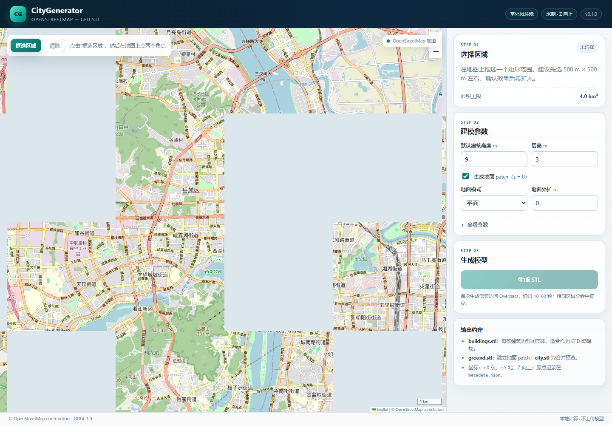
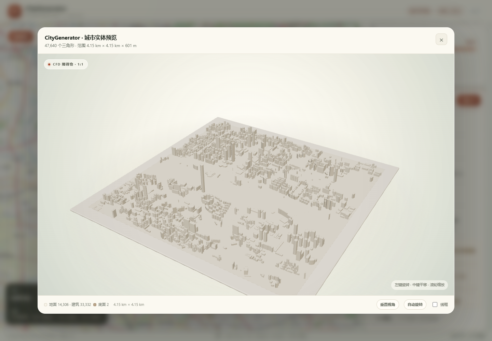

# CityGenerator

Generate a simulation-ready, **closed city solid** from OpenStreetMap (OSM)
building footprints for outdoor wind-environment CFD (OpenFOAM, STAR-CCM+,
Fluent, and similar solvers).

The app is a local FastAPI service with a browser UI:

1. Pan/zoom an OpenStreetMap basemap and drag a rectangle.
2. Set the default building height (25 m by default), level height, terrain
   options, and geometry cleanup options.
3. The backend fetches OSM footprints from Overpass, projects them into a local
   metric frame, samples DEM elevations into a solid terrain block, extrudes
   closed building shells on top of that terrain, and fuses everything into
   **one watertight `city.stl`**.
4. Download a ZIP or inspect the result in the built-in Three.js viewer.

All geometry is generated locally. OSM footprints and DEM elevation tiles are
the only external inputs; both are cached on disk.

[Chinese README](README.zh-CN.md)



The built-in viewer presents the fused city as a warm-white architectural model
on a display plinth, with soft studio lighting and left-drag orbit, middle-drag
pan, and wheel zoom. The viewer shows the fused STL with one material so the
preview does not invent a separate ground layer. It loads an internal
display-only preview mesh assembled from the clean building shells and the clean
base (the terrain block when terrain is enabled); that preview is not listed in
the job files or included in the ZIP. A logarithmic depth buffer prevents the
large ground surface from z-fighting at grazing angles. The exported `city.stl`
remains the single Z-up CFD mesh.



## Quick start

Requirements: Python 3.11+, internet access for the first Overpass request, for
the first DEM tile request, and for the basemap/Three.js CDN assets.

```powershell
# Windows PowerShell
python -m venv .venv
.\.venv\Scripts\Activate.ps1
pip install -e ".[dev]"
uvicorn app.main:app --reload --port 8000
```

```bash
# Linux / macOS
python3 -m venv .venv
source .venv/bin/activate
pip install -e ".[dev]"
uvicorn app.main:app --reload --port 8000
```

Open <http://127.0.0.1:8000/>. Use **Select area**, click two opposite corners,
adjust settings, and press **Generate STL**.

The UI is in Chinese; code, comments, metadata keys, and this README are in
English. A Chinese translation is available in [README.zh-CN.md](README.zh-CN.md).

### Headless CLI

The generation pipeline does not need the web server. After `pip install -e .`:

```powershell
citygen --bbox 29.560551,106.58197,29.569449,106.592431 --out .\out\chaotianmen
```

Without installing the console script:

```powershell
.\.venv\Scripts\python.exe -m app.cli --bbox 29.560551,106.58197,29.569449,106.592431 --out .\out\chaotianmen
```

`--bbox` is `south,west,north,east`. Other flags mirror the request options:
`--height`, `--level-height`, `--embed`, `--ground-margin`, `--simplify`,
`--min-area`, `--terrain-resolution`, `--no-terrain`, `--refresh`,
`--data-dir` (cache root), and `--quiet`. The CLI writes the same
`city.stl`/`patches.json`/`metadata.json`/`buildings.geojson`/`README.txt`/
`result.zip` bundle into `<out>/output/` and returns a non-zero exit code with
the error code on failure, so it can be used from batch scripts.

## Output

A completed job contains:

| File | Contents |
| --- | --- |
| `city.stl` | Binary STL. One fused, closed, outward-oriented city solid: buildings plus a terrain block (or a flat 1 m slab when terrain is off). |
| `patches.json` | Contiguous triangle ranges of `city.stl` labelled `ground`, `wall`, or `bottom`, in STL order, for CFD patch assignment. |
| `metadata.json` | Schema version, local origin, CRS, options, terrain provenance, statistics, warnings, source provenance, and city validation results. |
| `buildings.geojson` | WGS84 footprints with height, terrain ground height, roof height, source, and selected tags. |
| `README.txt` | Short human-readable notes and CFD import guidance. |
| `result.zip` | ZIP containing the five files above (it does not contain itself). |

There are **no separate `buildings.stl` or `ground.stl` files**. The city is
intended to be imported as one closed obstacle.

`patches.json` maps every triangle to one of three patches: `ground` (upward
triangles within `CITYGEN_PATCH_GROUND_TOLERANCE_M` of the terrain surface,
0.05 m by default), `wall` (buildings, roofs, and the vertical terrain skirt),
or `bottom` (the base underside). Ranges are contiguous and follow the STL
triangle order, so a solver or script can assign boundary patches by reading
the file in order.

### How the city is fused

1. Footprints are projected, cleaned, and their heights resolved in one pass, so
   the full building extent is known before the ground is built.
2. A terrain block is built over the union of the selected area and all building
   footprints, expanded by `ground_margin_m`. Its top is a DEM height field, its
   sides are vertical walls, and its bottom is a flat plane at
   `z = -ground_slab_thickness_m`; the block is closed by construction. With
   terrain disabled, a flat 1 m slab is used instead.
3. Each valid building is extruded as a closed shell and placed on the lowest
   terrain cell under its footprint, then embedded `0.5 m` below that height.
4. The building shells and the terrain block are boolean-unioned with
   [Manifold](https://github.com/elalish/manifold). Internal faces disappear, so
   the hill surface cuts each building at its natural ground line.
5. When two buildings touch only at an edge or corner, their volumes have no
   common interior, so the union is geometrically non-manifold. The pipeline
   detects those exact edges after an STL round-trip, clusters nearby bad edges,
   and adds a small solid weld box (0.4 m padding) around each cluster before
   re-running the union. The number of boxes is recorded as
   `city.weld_repairs`.
6. The written STL is loaded again and must pass watertightness, consistent
   winding, finite vertices, positive volume, and zero non-manifold edges. A
   failure is reported as `CITY_UNION_FAILED`; the pipeline never silently falls
   back to a concatenated triangle soup.

Most city models need zero or a small number of welds; dense areas with many
touching footprints can need more. They are local contact repairs, not a change
to the overall building layout.

**Why not just add a plane under everything?** The base already closes the
underside; the failure is above the base, where two building volumes meet along
a vertical line without sharing interior volume. No bottom surface can turn that
line contact into a manifold surface. A single closed solid requires a tiny
material bridge at the contact (or a gap that keeps the buildings separate).
The weld boxes are that bridge.

### Terrain

Terrain is enabled by default and comes from the
[AWS Terrain Tiles](https://registry.opendata.aws/terrain-tiles/) (Terrarium)
dataset: 256×256 PNG tiles with `metres = R*256 + G + B/256 - 32768`, derived
from SRTM/GMTED, no API key. The source is a ~30 m **surface** model, not bare
earth: in dense areas it follows roofs and tree canopy, and single cells can be
tens of metres off. The app therefore samples it on a 30 m local grid — the
native spacing of the source — and runs a ~150 m median filter
(`metadata.json → terrain.smoothing_m`), which removes that noise while keeping
real landforms.

- `terrain.resolution_m` (5–50 m) sets the terrain mesh spacing. It is
  coarsened automatically, with a warning, to keep the mesh under
  `max_terrain_cells`.
- Smoothing is deliberate: without it a single bad SRTM cell becomes a visible
  100 m-wide dome that does not exist on the ground. A 250 m mountain loses
  under 3 % of its relief to the filter, and a flat riverside block stays flat.
- The filter width is fixed in ground metres, so a finer `resolution_m` shows
  more detail but no new data – the source has none below ~30 m.
- The vertical datum is the **lowest terrain cell in the selection**, so `z = 0`
  stays the CFD floor. `metadata.json → terrain.datum_offset_m` is the value to
  add to restore absolute elevations from the source DEM.
- Each building is placed on the minimum terrain height under its footprint, so
  no building floats. On a slope the uphill side is buried; buildings whose
  footprint spans more than 3 m of relief raise `STEEP_FOOTPRINT`.
- DEM tiles are cached under `data/cache/dem/` with the same 7-day TTL as the
  OSM cache. A failed DEM request fails the job with `TERRAIN_FETCH_FAILED`
  rather than silently producing a flat site.

Set `terrain.enabled` to `false` for the flat v1 behaviour.

### Coordinate convention

- Units: metres.
- `+X` = east, `+Y` = north, `+Z` = up (the STL is Z-up).
- Origin: south-west corner of the selected WGS84 bounding box, projected to the
  appropriate UTM zone (`EPSG:326xx` north / `EPSG:327xx` south).
- `z = 0` is the lowest terrain cell in the selection (the ground plane when
  terrain is disabled). Models therefore start at `-ground_slab_thickness_m`.
- `metadata.json → local_frame.origin` records the origin's easting, northing,
  longitude, and latitude so the model can be georeferenced again.

Useful `metadata.json → city` fields:

```json
{
  "triangle_count": 28162,
  "watertight": true,
  "winding_consistent": true,
  "volume_m3": 34099814.3,
  "non_manifold_edges": 0,
  "base_thickness_m": 1.0,
  "terrain_triangle_count": 4140,
  "union_engine": "manifold",
  "weld_repairs": 8
}
```

Useful `metadata.json → terrain` fields:

```json
{
  "enabled": true,
  "source": "aws-terrarium",
  "zoom": 13,
  "pixel_m": 16.84,
  "resolution_m": 29.38,
  "grid": { "nx": 37, "ny": 40 },
  "smoothing_m": 146.9,
  "filter": "median 5x5 cells",
  "datum_offset_m": 18.69,
  "elevation_min_m": 18.69,
  "elevation_max_m": 56.89,
  "relief_m": 38.19,
  "max_footprint_relief_m": 8.9,
  "tiles": 2,
  "cached_tiles": 0,
  "nodata_pixels": 0,
  "nodata_filled_cells": 0,
  "z_reference": "lowest terrain cell in the selection"
}
```

## CFD import notes

1. Import `city.stl` as one closed obstacle patch or solid. You no longer need
   to combine two STL files.
2. Confirm the solver reads the file as metres and that `+Z` is up. If your
   solver uses Y-up, rotate `-90°` about X.
3. Create the fluid domain around the city: inlet, outlet, sides, and top.
   Recommended starting distances are 5H upstream, 10–15H downstream, 5H to the
   sides, and 5H above the tallest building, where H is the tallest height.
4. The ground is part of the solid, so there is no open ground patch to close.
   The underside of the terrain block is a valid closed boundary. With terrain
   enabled the ground surface is not flat: buildings on slopes are cut by the
   hill, which is the intended obstacle shape but will add near-wall cells.
5. Check `MISSING_HEIGHT`, `HEIGHT_CLAMPED`, and `STEEP_FOOTPRINT` warnings.
   Buildings without a height tag draw from the selection's own OSM height
   distribution, preferring heights from similarly sized footprints
   (0.25–4× the area; `buildings.height_sampling`), with a sampled ceiling for
   low-rise/civic/industrial types, so the skyline is locally plausible but
   still estimated, not surveyed.
6. Review `city.weld_repairs` if you need to know whether touching footprints
   required local contact repairs. A healthy run needs `0`.
7. If your mesh generator struggles with the terrain block, re-run with terrain
   disabled or a coarser `terrain.resolution_m`; the flat slab uses far fewer
   triangles.
8. This tool stops at surface STL. It does not create a volume mesh, boundary
   layers, turbulence settings, or solver dictionaries.

## API

| Method | Path | Purpose |
| --- | --- | --- |
| `GET` | `/api/health` | Liveness and version. |
| `GET` | `/api/config` | Limits, defaults, attribution, tile URL. |
| `POST` | `/api/jobs` | Create a generation job. Returns `202` and `job_id`. |
| `GET` | `/api/jobs/{job_id}` | Status, progress, stage, stats, warnings, files. |
| `GET` | `/api/jobs/{job_id}/download` | Download `result.zip` (completed jobs only). |
| `GET` | `/api/jobs/{job_id}/preview.stl` | Internal display-only preview mesh for the viewer. |
| `GET` | `/api/jobs/{job_id}/files/{name}` | Download a single output file. |
| `DELETE` | `/api/jobs/{job_id}` | Cancel a running job or delete a terminal job. |

Example request:

```json
{
  "bbox": { "south": 28.19, "west": 112.97, "north": 28.196, "east": 112.978 },
  "options": {
    "default_height_m": 25,
    "level_height_m": 3,
    "embed_depth_m": 0.5,
    "ground_margin_m": 0,
    "simplify_m": 0.05,
    "min_building_area_m2": 4,
    "terrain": { "enabled": true, "resolution_m": 25 }
  },
  "refresh": false
}
```

`bbox` must have `north > south` and `east > west`. `refresh` bypasses the
Overpass cache for that bounding box and re-fetches every chunk.
`terrain.resolution_m` must be between 5 and 50; coarser requests mean fewer
triangles, finer ones sample the DEM more closely but are limited by the source
resolution and `max_terrain_cells`.

Selections above `overpass_chunk_area_km2` (4 km²) are downloaded as a grid of
smaller Overpass requests and merged; the overall cap is `max_area_km2`
(17 km² by default). A chunk that still fails after its retries is retried as
four sub-cells (at most `overpass_split_max_depth = 2` levels, never below
`overpass_split_min_area_km2 = 0.25 km²`), so one busy endpoint does not fail the
whole job. `metadata.json → source.overpass_splits` records every split and
`source.overpass_cell_times` the time each cell took during that fetch.

Progress stages: `queued`, `starting`, `validating`, `fetching`, `parsing`,
`projecting`, `building`, `terrain`, `ground`, `fusing`, `exporting`, `completed`
(plus `failed`, `cancelling`, `cancelled`). The UI polls roughly once per second.

Terrain failures are explicit: `TERRAIN_FETCH_FAILED` (tiles could not be
downloaded) and `TERRAIN_DATA_MISSING` (no usable elevation in the area). Retry
later, or generate with `terrain.enabled: false`.

## Configuration

Settings use the `CITYGEN_` prefix and can be placed in `.env`:

```dotenv
CITYGEN_DATA_DIR=./data
CITYGEN_MAX_AREA_KM2=17
CITYGEN_OVERPASS_CHUNK_AREA_KM2=4
CITYGEN_MAX_BUILDINGS=20000
CITYGEN_MAX_WORKERS=2
CITYGEN_OVERPASS_ENDPOINTS=https://overpass-api.de/api/interpreter,https://overpass.kumi.systems/api/interpreter
CITYGEN_OVERPASS_TIMEOUT_S=180
CITYGEN_OVERPASS_MIN_INTERVAL_S=1.0
CITYGEN_OVERPASS_SPLIT_MAX_DEPTH=2
CITYGEN_OVERPASS_SPLIT_MIN_AREA_KM2=0.25
CITYGEN_JOB_TTL_DAYS=7
CITYGEN_CACHE_TTL_DAYS=7
CITYGEN_GROUND_SLAB_THICKNESS_M=1.0
CITYGEN_CONTACT_OVERLAP_M=0.1
CITYGEN_PATCH_GROUND_TOLERANCE_M=0.05
CITYGEN_HEIGHT_SAMPLING_ENABLED=true
CITYGEN_HEIGHT_SAMPLING_MIN_SAMPLES=5
CITYGEN_HEIGHT_SAMPLING_JITTER=0.1
CITYGEN_HEIGHT_SAMPLING_SEED=0
CITYGEN_TERRAIN_ENABLED_DEFAULT=true
CITYGEN_TERRAIN_RESOLUTION_M=25
CITYGEN_MAX_TERRAIN_CELLS=80000
CITYGEN_DEM_ZOOM_MIN=10
CITYGEN_DEM_ZOOM_MAX=14
CITYGEN_DEM_MAX_TILES=24
CITYGEN_DEM_TIMEOUT_S=20
CITYGEN_DEM_MAX_RETRIES=3
```

Useful defaults:

- Maximum selection area: `17 km²` (an exact 4 × 4 km box is 16.005 km² on the
  ellipsoid), fetched as several Overpass requests of at most
  `overpass_chunk_area_km2 = 4 km²` each, then merged; a cell that keeps
  timing out splits into four sub-cells, two levels deep and never below
  `0.25 km²`.
- Maximum accepted buildings: `20,000`.
- Default height: `25 m` for the rare selection that has too few tagged heights;
  otherwise untagged buildings sample the local OSM height distribution,
  preferring heights from footprints within `0.25–4×` their area
  (`height_sampling_jitter = 10 %`). Level height: `3 m`.
- Bottom embed depth: `0.5 m`; polygon simplification: `0.05 m`.
- Ground slab thickness: `1 m`.
- Patches: `patches.json` ground tolerance `0.05 m`.
- Terrain: enabled, `30 m` grid, `150 m` median smoothing, max `80,000` cells,
  DEM zoom `10–14`.
- Job retention / Overpass and DEM cache retention: `7 days`.
- Worker threads: `2`.

Cache and jobs live under `data/cache/osm/`, `data/cache/dem/`, and
`data/jobs/<job_id>/`. All are ignored by git.

## Development

```powershell
.\.venv\Scripts\python.exe -m pytest tests -q
.\.venv\Scripts\python.exe -m ruff check app tests
```

Tests are offline by default: Overpass and the DEM source are replaced with
synthetic fixtures. Two optional live smoke tests are marked `network` and
skipped unless explicitly enabled:

```powershell
$env:CITYGEN_RUN_NETWORK = "1"
.\.venv\Scripts\python.exe -m pytest tests/test_live_overpass.py tests/test_live_dem.py -q -m network
```

The suite includes a round-trip regression test for edge-touching buildings: the
fused city must remain watertight and have zero non-manifold edges after being
written to binary STL and loaded again. Terrain tests cover plane/diagonal
sampling, conservative footprint minima, closed terrain solids, watertight
building-on-slope unions, and Terrarium tile decoding/mosaicking.

CI runs `ruff check app tests` and the offline `pytest` suite on every push and
pull request (`.github/workflows/ci.yml`). `tests/test_golden.py` builds a fixed
300 m 25-building block on a synthetic terrain ramp and compares triangle count,
volume, surface area, bounds, weld repairs, watertightness, non-manifold edges,
and the maximum terrain border step against `tests/golden/city_300m.json`, so a
geometry change shows up as a reviewable diff. After an intended change,
regenerate it and review the JSON:

```powershell
$env:UPDATE_GOLDEN = "1"
.\.venv\Scripts\python.exe -m pytest tests/test_golden.py
Remove-Item Env:UPDATE_GOLDEN
```

## Limits (v2)

Terrain is a smoothed 30 m grid sampled from ~30 m DEM data: it is not a survey,
it has no cliff/building/vegetation detail, and streams are not carved. No
roads, vegetation, water, pitched roofs, `building:part`, or volumetric meshing.
Every building is a vertical prism placed on the lowest cell under its
footprint; touching footprints are fused with local weld repairs rather than
merged into shared architectural geometry. Multi-user auth, queue persistence
across restarts, and distributed workers are out of scope.

## Data licence and attribution

OSM data is © OpenStreetMap contributors, licensed under
[ODbL 1.0](https://www.openstreetmap.org/copyright). Terrain data comes from the
[AWS Terrain Tiles](https://registry.opendata.aws/terrain-tiles/) open dataset
(Mapzen/Amazon, derived from SRTM and other public DEMs). Attribution is
embedded in `metadata.json`, `README.txt`, the UI, and this document. Generated
geometry derived from OSM remains subject to ODbL attribution/share-alike
requirements.

Frontend libraries: [Leaflet](https://leafletjs.com/) (BSD-2-Clause) and
[Three.js](https://threejs.org/) (MIT), loaded from jsDelivr. Basemap tiles are
served by the OpenStreetMap tile servers.
