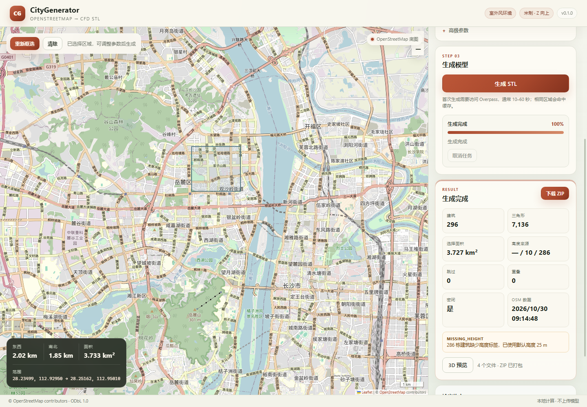
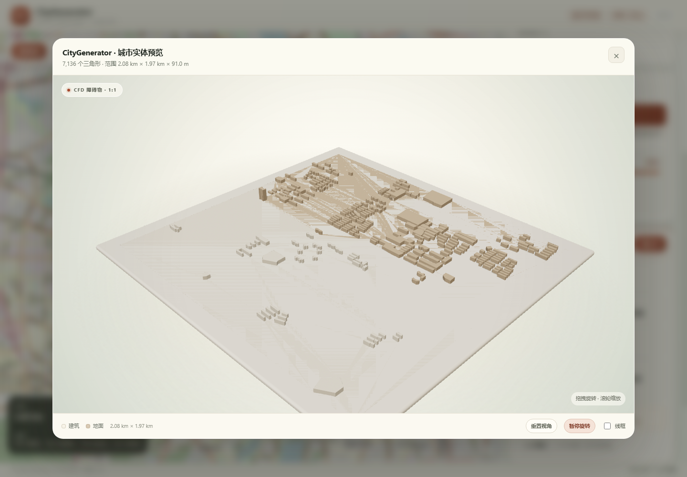

# CityGenerator

从 OpenStreetMap（OSM）建筑轮廓生成可直接导入室外风环境 CFD 软件
（OpenFOAM、STAR-CCM+、Fluent 等）的**单一密闭城市实体 STL**。

本项目是一个本地 FastAPI 服务，附带浏览器界面：

1. 在 OpenStreetMap 底图上缩放、平移，拖拽框选区域。
2. 设置默认建筑高度（默认 **25 m**）、层高和几何清理参数。
3. 后端通过 Overpass 获取 OSM 建筑轮廓，投影到本地米制坐标系，拉伸为闭合
   建筑壳体，生成实体地面底座，并将所有几何融合为**一个水密的
   `city.stl`**。
4. 下载 ZIP，或在内置 Three.js 查看器中检查结果。

所有几何都在本地生成。OSM 数据是唯一的外部输入，并会缓存到磁盘。

[English README](README.md)



内置查看器把融合后的城市呈现为暖白色建筑模型，放置在展示底座上，带柔和
的棚拍阴影和轨道控制。查看器只按三角形高度把单一 STL 临时分成建筑和地面
两种材质用于显示；导出的文件仍然是一个 Z 轴向上的整体网格。



## 快速开始

环境要求：Python 3.11+；首次 Overpass 请求以及底图/Three.js CDN 资源需要
联网。

```powershell
# Windows PowerShell
python -m venv .venv
.\.venv\Scripts\Activate.ps1
pip install -e ".[dev]"
uvicorn app.main:app --reload --port 8000
```

```bash
# Linux / macOS
python3 -m venv .venv
source .venv/bin/activate
pip install -e ".[dev]"
uvicorn app.main:app --reload --port 8000
```

打开 <http://127.0.0.1:8000/>，点击 **框选区域**，依次点击矩形对角两点，
调整参数后点击 **生成 STL**。

界面为中文；代码、注释、元数据字段和英文 README 使用英文。中文说明即本文
件。

## 输出内容

任务完成后包含：

| 文件 | 内容 |
| --- | --- |
| `city.stl` | 二进制 STL。一个融合、闭合、法线朝外的城市实体：全部建筑 + 1 m 厚地面底座。 |
| `metadata.json` | 模式版本、本地原点、CRS、参数、统计、警告、数据来源和城市实体校验结果。 |
| `buildings.geojson` | WGS84 建筑轮廓，含高度、基底、来源和筛选后的标签。 |
| `README.txt` | 简短说明和 CFD 导入建议。 |
| `result.zip` | 上述全部文件的压缩包。 |

**不再分别输出 `buildings.stl` 和 `ground.stl`**。城市实体按一个闭合障碍物
导入。

### 城市实体如何融合

1. 每栋有效建筑拉伸为闭合壳体；默认把底部下沉 `0.5 m` 到 `z = 0` 以下。
2. 在框选范围与全部建筑轮廓的并集下方生成 1 m 厚实体底座，并向外扩展
   `ground_margin_m`。
3. 使用 [Manifold](https://github.com/elalish/manifold) 对建筑壳体和底座做
   布尔并集，内部面会被消除。
4. 如果两栋建筑只在一条边或一个角点接触，它们的体积没有公共内部，并集在
   几何上就是非流形的。流水线会在 STL 回读后定位这些具体的边，在接触处
   加入半径 `0.25 m` 的小圆柱“焊接补丁”，再重新做并集。补丁数量记录在
   `city.weld_repairs`。
5. 写出的 STL 会被重新读入，必须通过水密、法线一致、顶点有限、体积为正、
   非流形边为零的检查。失败会返回 `CITY_UNION_FAILED`；不会静默退化为
   简单拼接的三角面片。

大多数城市模型不需要补丁，或只需要少量补丁。它们只修复局部接触，不改变
整体建筑布局。

### 坐标约定

- 单位：米。
- `+X` = 东，`+Y` = 北，`+Z` = 上（STL 为 Z-up）。
- 原点：所选 WGS84 包围盒的西南角，投影到合适的 UTM 带
  （北半球 `EPSG:326xx`，南半球 `EPSG:327xx`）。
- `metadata.json → local_frame.origin` 记录原点的东坐标、北坐标、经度和
  纬度，便于重新地理配准。

`metadata.json → city` 的主要字段：

```json
{
  "triangle_count": 7136,
  "watertight": true,
  "winding_consistent": true,
  "volume_m3": 12294326.099,
  "non_manifold_edges": 0,
  "base_thickness_m": 1.0,
  "union_engine": "manifold",
  "weld_repairs": 8
}
```

## CFD 导入建议

1. 把 `city.stl` 作为**一个**闭合障碍物或实体导入，不再需要拼合两个 STL。
2. 确认求解器按米读取文件，且 `+Z` 向上。如果求解器使用 Y-up，绕 X 轴
   旋转 `-90°`。
3. 在城市周围建立流体域：入口、出口、侧面和顶部。建议初始距离为上游
   `5H`、下游 `10–15H`、两侧 `5H`、顶部 `5H`，其中 `H` 为最高建筑高度。
4. 地面已经包含在实体中，不需要再封闭开放的地面片；底座下表面本身就是
   闭合边界。
5. 检查 `MISSING_HEIGHT` 和 `HEIGHT_CLAMPED` 警告。默认 25 m 是占位值，
   不是实测高度。
6. 如需了解是否有建筑轮廓发生接触修复，查看 `city.weld_repairs`。
7. 本工具只输出表面 STL，不生成体网格、边界层、湍流参数或求解器算例。

## API

| 方法 | 路径 | 用途 |
| --- | --- | --- |
| `GET` | `/api/health` | 存活检查和版本。 |
| `GET` | `/api/config` | 限制、默认值、数据署名、底图地址。 |
| `POST` | `/api/jobs` | 创建生成任务，返回 `202` 和 `job_id`。 |
| `GET` | `/api/jobs/{job_id}` | 状态、进度、阶段、统计、警告和文件列表。 |
| `GET` | `/api/jobs/{job_id}/download` | 下载 `result.zip`（仅已完成任务）。 |
| `GET` | `/api/jobs/{job_id}/files/{name}` | 下载单个输出文件。 |
| `DELETE` | `/api/jobs/{job_id}` | 取消运行中的任务，或删除已结束任务。 |

请求示例：

```json
{
  "bbox": { "south": 28.19, "west": 112.97, "north": 28.196, "east": 112.978 },
  "options": {
    "default_height_m": 25,
    "level_height_m": 3,
    "embed_depth_m": 0.5,
    "ground_margin_m": 0,
    "simplify_m": 0.05,
    "min_building_area_m2": 4
  },
  "refresh": false
}
```

`bbox` 必须满足 `north > south` 且 `east > west`。`refresh` 会跳过该包围盒
的 Overpass 缓存。

进度阶段：`queued`、`starting`、`validating`、`fetching`、`parsing`、
`projecting`、`building`、`ground`、`fusing`、`exporting`、`completed`
（以及 `failed`、`cancelling`、`cancelled`）。界面约每秒轮询一次。

## 配置

配置使用 `CITYGEN_` 前缀，可写入 `.env`：

```dotenv
CITYGEN_DATA_DIR=./data
CITYGEN_MAX_AREA_KM2=4
CITYGEN_MAX_BUILDINGS=20000
CITYGEN_MAX_WORKERS=2
CITYGEN_OVERPASS_ENDPOINTS=https://overpass-api.de/api/interpreter,https://overpass.kumi.systems/api/interpreter
CITYGEN_OVERPASS_TIMEOUT_S=180
CITYGEN_OVERPASS_MIN_INTERVAL_S=1.0
CITYGEN_JOB_TTL_DAYS=7
CITYGEN_CACHE_TTL_DAYS=7
CITYGEN_GROUND_SLAB_THICKNESS_M=1.0
```

主要默认值：

- 最大框选面积：`4 km²`。
- 最大建筑数：`20,000`。
- 默认高度：`25 m`；层高：`3 m`。
- 底部下沉深度：`0.5 m`；轮廓简化：`0.05 m`。
- 地面底座厚度：`1 m`。
- 任务保留 / Overpass 缓存保留：`7 天`。
- 工作线程：`2`。

缓存和任务位于 `data/cache/osm/` 与 `data/jobs/<job_id>/`，均已被 git
忽略。

## 开发

```powershell
.\.venv\Scripts\python.exe -m pytest tests -q
.\.venv\Scripts\python.exe -m ruff check app tests
```

测试默认离线：Overpass 使用 mock，OSM 数据为合成 fixture。可选的真实
Overpass 冒烟测试标记为 `network`，默认跳过：

```powershell
$env:CITYGEN_RUN_NETWORK = "1"
.\.venv\Scripts\python.exe -m pytest tests/test_live_overpass.py -q -m network
```

测试套件包含一个“建筑仅边接触”的 STL 回读回归测试：融合后的城市在写成
二进制 STL 并重新读入后，仍必须水密且非流形边为零。

## 限制（v1）

不支持 DEM/地形、道路、植被、水体、坡屋顶、`building:part` 或体网格。
每栋建筑都是竖直棱柱；接触的建筑轮廓通过局部焊接融合，而不是合并成共享
的建筑细节。多用户认证、重启后的队列持久化和分布式 worker 不在范围内。

## 数据许可与署名

OSM 数据 © OpenStreetMap contributors，采用
[ODbL 1.0](https://www.openstreetmap.org/copyright) 许可。署名信息嵌入
`metadata.json`、`README.txt`、界面和本文档。由 OSM 派生的几何仍受 ODbL
署名/相同方式共享要求约束。

前端库：[Leaflet](https://leafletjs.com/)（BSD-2-Clause）和
[Three.js](https://threejs.org/)（MIT），从 jsDelivr 加载。底图瓦片由
OpenStreetMap 瓦片服务器提供。
